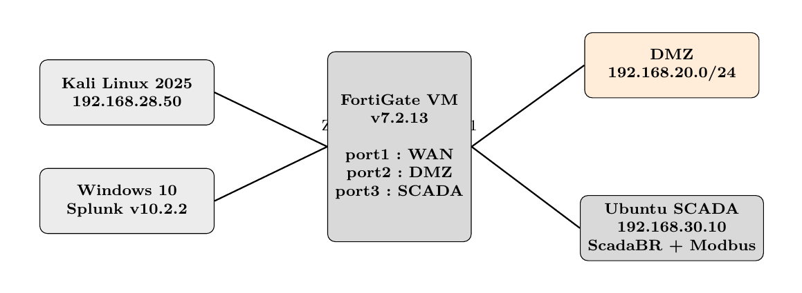
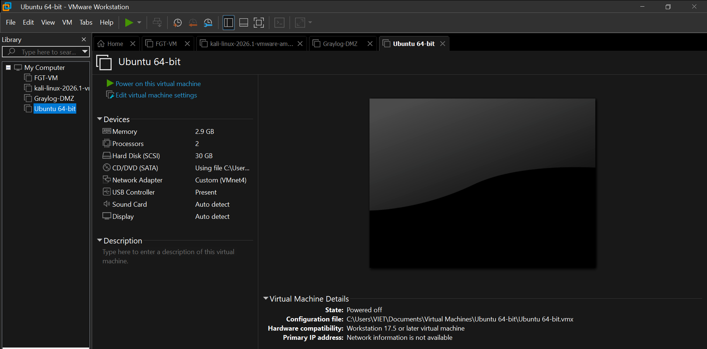
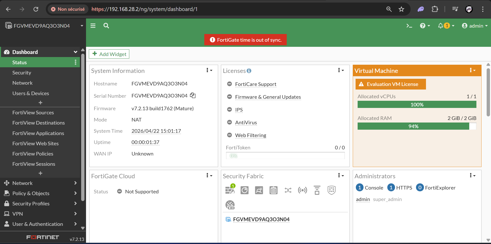
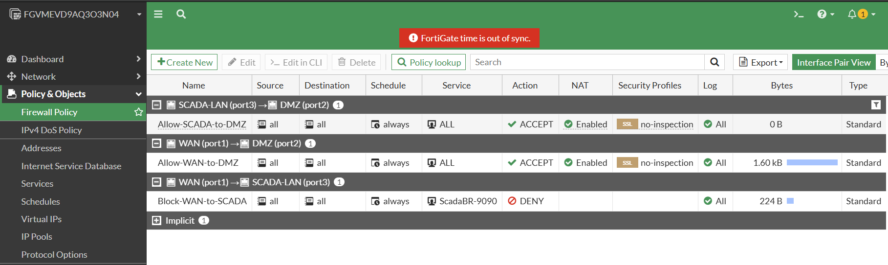
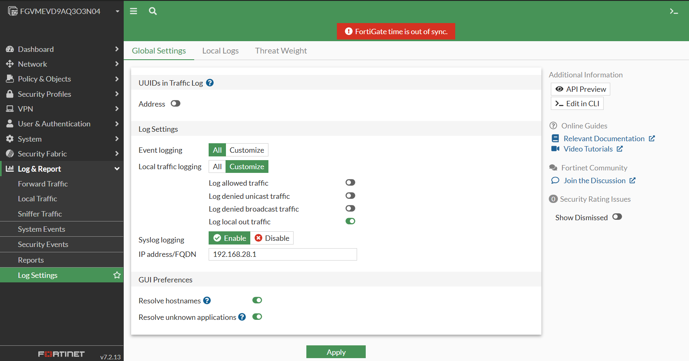
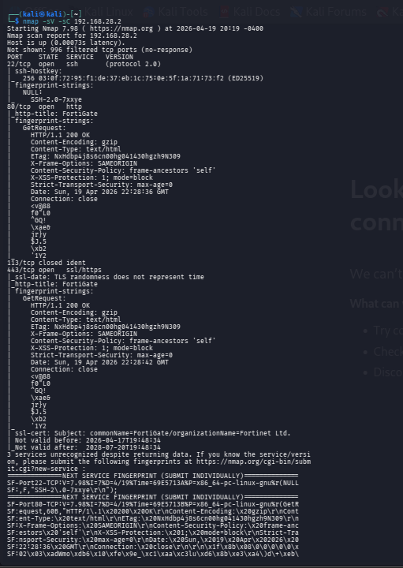
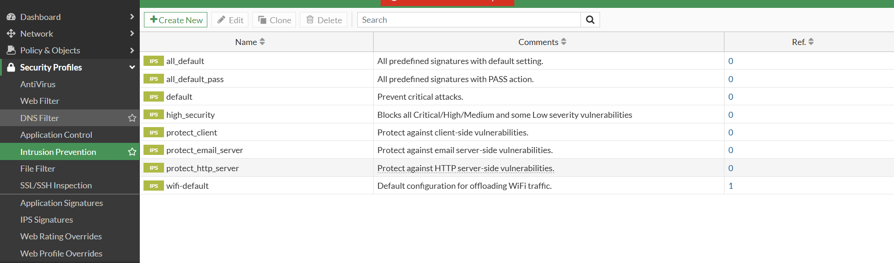
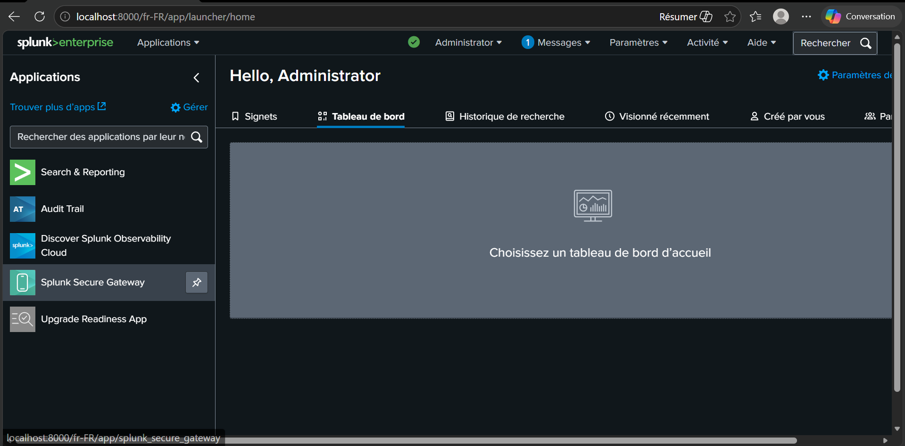
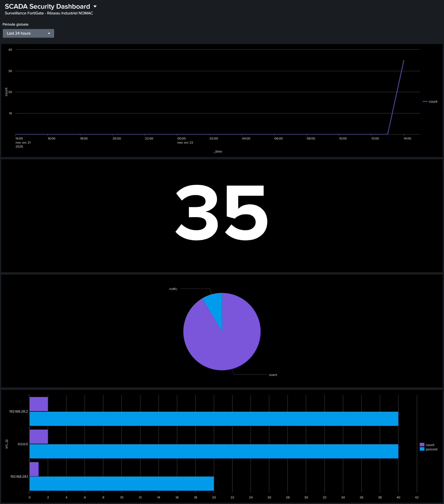
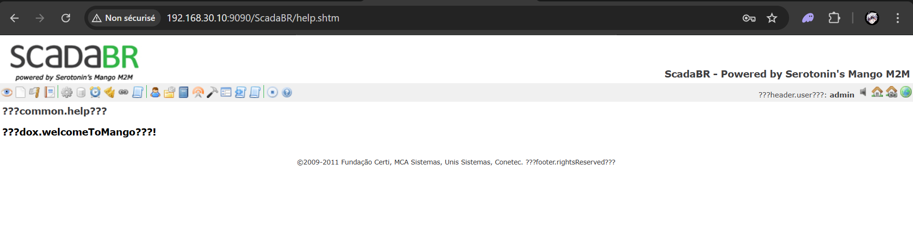

# Cybersecurity Architecture for SCADA Systems and Industrial Networks


Projet de fin d'études (PFE) – EST Ouarzazate (Université Ibn Zohr) 2025/2026
Encadrante : **Mme Khadija TOUYA (EST Ouarzazate)** – Encadrant industriel :
**M. Fidae AMARA (NOMAC)**

## Contexte et problématique

La convergence des technologies IT/OT expose les systèmes SCADA à des
cybermenaces croissantes. Le protocole **Modbus TCP**, largement utilisé dans
l'industrie, ne dispose d'**aucun mécanisme d'authentification ni de
chiffrement**, ce qui rend les réseaux industriels vulnérables aux intrusions,
aux inondations réseau et à la manipulation des registres de contrôle.

Ce projet conçoit et met en œuvre une **architecture de cybersécurité en couches**
protégeant le réseau industriel de la centrale solaire CSP **Nour 1 (NOMAC)**, et
en valide l'efficacité par une campagne de **tests d'intrusion**.

## Objectifs

- Segmenter et cloisonner les zones WAN, DMZ et SCADA autour d'un **FortiGate VM**.
- Appliquer une politique **deny-all** et des règles de contrôle d'accès par zone.
- Déployer un **IPS industriel** pour détecter et bloquer les attaques réseau.
- Collecter et corréler les journaux de sécurité dans **Splunk (SIEM)**.
- Valider la défense par une campagne de tests d'intrusion depuis Kali Linux.

## Architecture en 5 couches

| N° | Couche                          | Composant                                   |
|----|---------------------------------|---------------------------------------------|
| 1  | Contrôle périmétrique           | FortiGate deny-all, règles par zone         |
| 2  | Isolation VLAN/DMZ              | Réseaux host-only VMware (VMnet1/3/4)       |
| 3  | Chiffrement VPN IPsec           | IKEv2, AES-256-GCM                          |
| 4  | IPS industriel                  | Profil IPS dédié SCADA (Flood, SSH, Modbus) |
| 5  | Supervision SIEM                | Splunk Enterprise 10.2.2                    |

## Pile technologique

| Technologie                | Version / Détail        |
|----------------------------|-------------------------|
| FortiGate VM               | v7.2.13                 |
| Splunk Enterprise          | 10.2.2                  |
| ScadaBR                    | 1.0CE (Tomcat 6.0.53)   |
| pymodbus (simulateur)      | 3.13.0                  |
| Kali Linux (tests)         | 2025                    |
| Ubuntu (serveur SCADA)     | 22.04                   |
| VMware Workstation Pro     | Réseaux host-only       |

## Tests de pénétration

| Scénario                  | Résultat                  |
|---------------------------|---------------------------|
| Scan reconnaissance WAN   | Détecté                   |
| Accès zone SCADA (WAN)    | Bloqué                    |
| Inondation ICMP           | Détecté et bloqué         |
| Inondation SYN (443)      | Détecté et bloqué         |
| Force brute SSH           | Détecté et bloqué         |
| Scan de vulnérabilités    | Détecté et journalisé     |

**Bilan : 5 scénarios sur 6 détectés et bloqués** – 100 % journalisés dans Splunk.

## Structure du dépôt

```
.
├── configs/
│   ├── fortigate/        # Configuration FortiGate (interfaces, politiques, IPS, syslog)
│   └── ubuntu/           # Configuration réseau Ubuntu (Netplan)
├── docs/
│   └── architecture.md   # Documentation de l'architecture (zones, interfaces, machines)
├── images/               # Captures d'écran (topologie VMware, FortiGate, IPS, Splunk, ScadaBR)
├── rapport/              # Rapport de PFE
├── scripts/              # Simulateur Modbus pymodbus, scripts de correction réseau
└── tests/                # Tests d'intrusion (Nmap, hping3, Hydra) et scénarios
```

## Captures d'écran

### Topologie du laboratoire



*Topologie du laboratoire (FortiGate VM, zones WAN / DMZ / SCADA)*

### Machines virtuelles VMware



*Machines virtuelles sous VMware Workstation Pro*

### Tableau de bord FortiGate



*Tableau de bord du FortiGate VM v7.2.13*

### Politiques de sécurité



*Politiques de sécurité du pare-feu (dont Block-WAN-to-SCADA)*

### Journaux Syslog



*Envoi des journaux Syslog vers Splunk*

### Scan Nmap sur la zone WAN



*Scan Nmap depuis Kali Linux sur la zone WAN*

### Scan de la zone SCADA bloqué


*Scan de la zone SCADA bloqué par le FortiGate*

### Profils IPS FortiGate



*Profils IPS du FortiGate*

### Interface Splunk Enterprise



*Interface Splunk Enterprise*

### SCADA Security Dashboard



*SCADA Security Dashboard dans Splunk*

### Interface ScadaBR



*Interface ScadaBR*

## Auteur

**Haytam TOUILE** – Étudiant en Bachelor Réseaux, Cloud et Cybersécurité,
ancien étudiant GRS à l'EST Ouarzazate.

- LinkedIn : [linkedin.com/in/...](#)
- Email : `auteur@exemple.com`

## Perspectives

**Production :**

- Mise à jour de FortiOS vers la dernière version maintenue.
- Licence **FortiGuard OT Security** pour la protection des protocoles industriels.
- Migration de ScadaBR vers **ScadaLTS**.
- Sécurisation du bus Modbus par **TLS** ou évolution vers **OPC-UA**.
- Authentification multifacteur (**MFA**) sur l'ensemble des accès.

**Cloud :**

- Déploiement de l'architecture sur **AWS/Azure**.
- Déploiement par **Infrastructure as Code** (Terraform/CloudFormation).
- SIEM **cloud-native** pour une corrélation à grande échelle.

## Avertissement

Simulation strictement isolée en laboratoire VMware (réseaux host-only), à but
pédagogique. Les données NOMAC sont **anonymisées**. Aucune infrastructure de
production n'est visée. Usage autorisé uniquement dans le cadre de ce PFE.